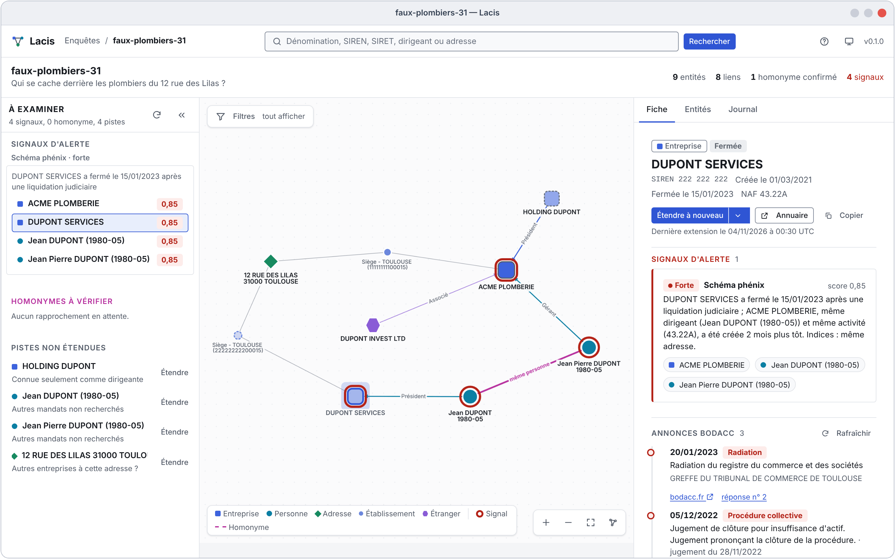

# Lacis

**Desktop OSINT tool that maps French companies, their directors and addresses into a sourced link graph, and flags patterns worth a closer look.**

Start from one company and Lacis pulls the threads: who runs it, which other companies those people run, who else is registered at the same address, and what the BODACC published about each of them. Explainable rules then flag the patterns that deserve a review, such as mass domiciliation, serial short-lived companies or phoenix schemes. Every fact in the graph links back to the exact response it came from, with its date and its SHA-256 fingerprint.

> [!NOTE]
> **Lacis is in early development.** Nothing is released yet. The images below are the **design target for v0.1.0**, not screenshots of the current application.

### Design target for v0.1.0

<picture>
  <source media="(prefers-color-scheme: dark)" srcset="docs/images/design-target-dark.png">
  
</picture>

Mockup of the main window, in the theme of your system. All companies and people shown are fictional. The interface of Lacis is in French.

## The name

*Lacis* (pronounced "la-see") is a French word for a network of interlaced threads. It describes a maze of narrow streets, a mesh of blood vessels or nerves, and an old craft of lace darned on a knotted net. It comes from the same root as *lacer*, to lace.

That is what Lacis draws: companies, people and addresses interlaced by mandates and registrations, untangled one thread at a time.

## Why

French company data is open (SIRENE, RNE, BODACC) but scattered, and free tools stop at "look up one company". Investigating a scam, vetting a supplier or understanding a network of shell companies means pivoting by hand across dozens of pages, and losing track of where each piece of information came from.

Lacis does the pivots and keeps the evidence:

- **Graph first.** Companies, establishments, people and addresses are nodes; mandates and registrations are links.
- **History, not just state.** BODACC notices tell what happened to each company, and when: insolvency proceedings, removals, changes, transfers.
- **Signals that tell you where to look.** Each signal has a severity, a score and a one-sentence explanation with figures, and points to the entities that justify it. A signal prioritises the investigation; it does not conclude it.
- **Evidence by design.** Raw responses are stored and hashed. Every entity lists the requests that produced it. A collection log records every call.
- **Homonyms made visible.** Two people are never merged on a mere resemblance. A match is proposed with a confidence level and its reasons, and the investigator decides.
- **Local only.** Each investigation is a SQLite file on your disk. Nothing leaves your computer except the public requests you trigger.
- **Built for French data.** SIREN, SIRET, directors that are people or companies, month of birth, non-diffusible companies, companies registered abroad.

## Planned for v0.1.0

The first release brings the capabilities of the former web prototype to the desktop, with the same interface.

- **Investigations**, each with its own database and its starting question.
- **Search** in the national company register by name, SIREN, SIRET, director or address, and adding results to the investigation.
- **Pivots** from a company to its establishments, addresses and directors; from a person to every company they run; from an address to every company registered there; with a depth from 1 to 3 and a cap on new entities.
- **BODACC notices** for each company, grouped by family, with the court, the judgment, a link to bodacc.fr and the fingerprint of the response.
- **Homonym review** with "certain", "probable" and "weak" matches and their reasons, and the investigator's decisions remembered.
- **Foreign entities**: foreign companies that run a French company, and companies under foreign law registered in France.
- **Warning signals** from configurable rules: mass domiciliation, serial short-lived companies, phoenix scheme, burst of creations, registered office moved abroad.
- **Main window**: the « À examiner » review queue, the interactive graph, and the details panel with its « Fiche », « Entités » and « Journal » tabs.
- **Light and dark themes**, following the system by default.
- **Keyboard and screen reader foundations**: accessible names, logical focus order and visible focus everywhere.
- **Packages** for Debian, Fedora, Arch Linux and Windows.

The issues of each version are grouped in the [milestones](https://github.com/c4seus/lacis/milestones).

## Data sources

Lacis queries public French open data only:

| Source | Content |
|---|---|
| [API Recherche d'entreprises](https://recherche-entreprises.api.gouv.fr/) | Companies, establishments, directors and addresses from SIRENE and the RNE |
| [BODACC](https://www.bodacc.fr/) | Official notices: creations, changes, insolvency proceedings, removals |

Requests are rate limited below the quota of each API, retried on temporary errors and cached per investigation.

## Installation

There is no release yet. Once v0.1.0 is out, packages will be attached to each [GitHub release](https://github.com/c4seus/lacis/releases):

| Platform | Package |
|---|---|
| Debian 13 and later, and derivatives | `.deb` |
| Fedora 41 and later | `.rpm` |
| Arch Linux | `.pkg.tar.zst` |
| Windows 10 and 11 | `.exe` installer |
| Any platform | source archive |

The reasons behind these formats are in [ADR 0002](docs/adr/0002-packaging.md).

To run Lacis from source today, see the development setup in [CONTRIBUTING.md](CONTRIBUTING.md#development-setup).

## Responsible use

Lacis works on public, legally published company data. It helps investigators, journalists, compliance teams and citizens understand who is behind a company. Signals are leads, not accusations: always check the sources before drawing a conclusion about a company or a person, and respect the rules that apply to personal data in your country.

## Contributing

Contributions are welcome. Read [CONTRIBUTING.md](CONTRIBUTING.md) first: it describes the branches, the commit convention, the code style and the tests every pull request must include. The technical choices are recorded in the [architecture decision records](docs/adr/README.md).

To report a vulnerability, follow [SECURITY.md](SECURITY.md).

## License

Lacis is free software, released under the [GNU General Public License v3.0 or later](LICENSE).
