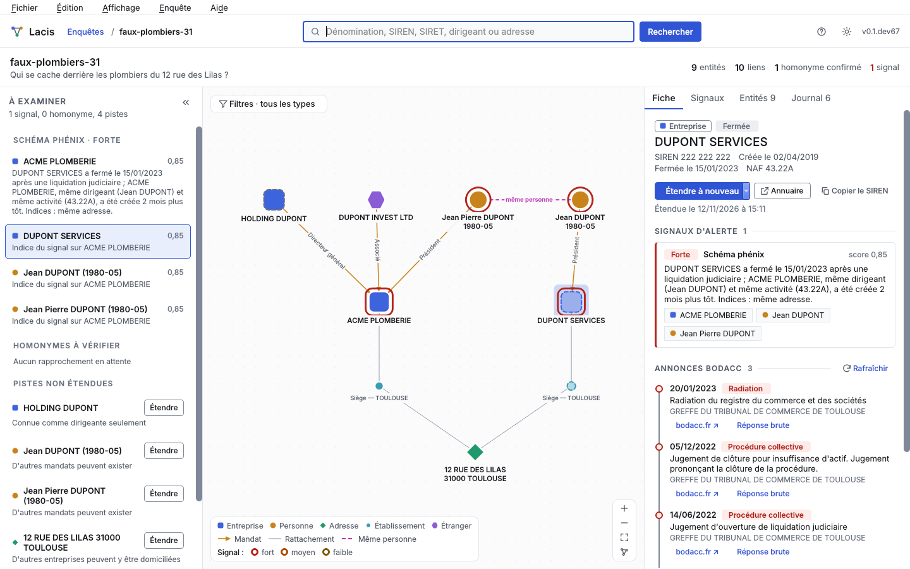

# Lacis

[](https://github.com/c4seus/lacis/actions/workflows/ci.yml)
[](https://github.com/c4seus/lacis/actions/workflows/codeql.yml)


[](LICENSE)

**Desktop OSINT tool that maps French companies, their directors and addresses into a sourced link graph, and flags patterns worth a closer look.**

Start from one company and Lacis pulls the threads: who runs it, which other companies those people run, who else is registered at the same address, and what the BODACC published about each of them. Explainable rules then flag the patterns that deserve a review, such as mass domiciliation, serial short-lived companies or phoenix schemes. Every fact in the graph links back to the exact response it came from, with its date and its SHA-256 fingerprint.

> [!NOTE]
> **Lacis is in its `0.y` phase.** The interface, the investigation format and the rule configuration can still change between minor versions, as described in the [versioning policy](docs/versioning.md).



<sub>A fictional investigation in the main window. All companies and people shown are fictional. The interface of Lacis is in French, in a light or a dark theme.</sub>

## The name

*Lacis* (pronounced "la-see") is a French word for a network of interlaced threads. It describes a maze of narrow streets, a mesh of blood vessels or nerves, and an old craft of lace darned on a knotted net. It comes from the same root as *lacer*, to lace.

That is what Lacis draws: companies, people and addresses interlaced by mandates and registrations, untangled one thread at a time.

## Why

French company data is open (SIRENE, RNE, BODACC) but scattered, and free tools stop at "look up one company". Investigating a scam, vetting a supplier or understanding a network of shell companies means pivoting by hand across dozens of pages, and losing track of where each piece of information came from.

Lacis does the pivots and keeps the evidence:

- **Graph first.** Companies, establishments, people and addresses are nodes; mandates and registrations are links.
- **History, not just state.** BODACC notices tell what happened to each company, and when: insolvency proceedings, removals, changes, transfers.
- **Signals that tell you where to look.** Each signal has a severity, a score and a one-sentence explanation with figures, and points to the entities that justify it. A signal prioritises the investigation; it does not conclude it.
- **Evidence by design.** Raw responses are stored and hashed. Every entity lists the requests that produced it. A collection log records every call.
- **Homonyms made visible.** Two people are never merged on a mere resemblance. A match is proposed with a confidence level and its reasons, and the investigator decides.
- **Local only.** Each investigation is a SQLite file on your disk. Nothing leaves your computer except the public requests you trigger.
- **Built for French data.** SIREN, SIRET, directors that are people or companies, month of birth, non-diffusible companies, companies registered abroad.

## Features

Version 0.1.0 brings the capabilities of the former web prototype to the desktop, with the same interface.

- **Investigations**, each with its own database and its starting question.
- **Search** in the national company register by name, SIREN, SIRET, director or address, and adding results to the investigation.
- **Pivots** from a company to its establishments, addresses and directors; from a person to every company they run; from an address to every company registered there; with a depth from 1 to 3 and a cap on new entities.
- **BODACC notices** for each company, grouped by family, with the court, the judgment, a link to bodacc.fr and the fingerprint of the response.
- **Homonym review** with "certain", "probable" and "weak" matches and their reasons, and the investigator's decisions remembered.
- **Foreign entities**: foreign companies that run a French company, and companies under foreign law registered in France.
- **Warning signals** from configurable rules: mass domiciliation, serial short-lived companies, phoenix scheme, burst of creations, registered office moved abroad.
- **Main window**: the « À examiner » review queue, the interactive graph, and the details panel with its « Fiche », « Entités » and « Journal » tabs.
- **Light and dark themes**, following the system by default.
- **Keyboard and screen reader foundations**: accessible names, logical focus order and visible focus everywhere.
- **Packages** for Debian, Fedora, Arch Linux and Windows.

The changes of each version are listed in the [changelog](CHANGELOG.md), the issues of the next versions are grouped in the [milestones](https://github.com/c4seus/lacis/milestones), and version numbers follow the [versioning policy](docs/versioning.md).

## Data sources

Lacis queries public French open data only:

| Source | Content |
|---|---|
| [API Recherche d'entreprises](https://recherche-entreprises.api.gouv.fr/) | Companies, establishments, directors and addresses from SIRENE and the RNE |
| [BODACC](https://www.bodacc.fr/) | Official notices: creations, changes, insolvency proceedings, removals |

Requests are rate limited below the quota of each API, retried on temporary errors and cached per investigation.

## Installation

Each [GitHub release](https://github.com/c4seus/lacis/releases) carries a package for each platform below, the source archive and a `SHA256SUMS` file. Download the file of your platform and `SHA256SUMS`, [verify the download](#verify-a-download), then install it as described below.

| Platform | File |
|---|---|
| Debian 13 and later, and derivatives that ship PySide6 6.8 or later | `lacis_X.Y.Z_all.deb` |
| Fedora, one package per maintained release | `lacis-X.Y.Z-1.fcNN.noarch.rpm` |
| Arch Linux | `lacis-X.Y.Z-1-any.pkg.tar.zst` |
| Windows 10 (version 1809 or later) and Windows 11, 64-bit | `lacis-X.Y.Z-windows-x64-setup.exe` |
| Other platforms | `lacis-X.Y.Z.tar.gz`, the source archive |

`X.Y.Z` stands for the version of Lacis, and `NN` for the Fedora release. The reasons behind these formats are in [ADR 0002](docs/adr/0002-packaging.md).

### Debian and derivatives

```bash
sudo apt install ./lacis_X.Y.Z_all.deb
```

apt installs the dependencies from the repositories of your distribution, and Lacis appears in the menu of your desktop. To remove it: `sudo apt remove lacis`.

### Fedora

Download the package whose name ends with your Fedora release, for example `fc45` for Fedora 45, then install it with dnf:

```bash
sudo dnf install ./lacis-X.Y.Z-1.fc45.noarch.rpm
```

dnf installs the dependencies too. Do not use `rpm -i`: the package is not signed, and Fedora 45 refuses unsigned packages with it. To remove Lacis: `sudo dnf remove lacis`.

### Arch Linux

```bash
sudo pacman -Syu
sudo pacman -U ./lacis-X.Y.Z-1-any.pkg.tar.zst
```

Update the system first: the package is built for the Python version that Arch Linux ships on the day of the release. When Arch Linux moves to a new Python version, the package stops working until the next release of Lacis. To remove it: `sudo pacman -R lacis`.

### Windows

Run `lacis-X.Y.Z-windows-x64-setup.exe`. By default, it installs Lacis for your account only, without administrator rights, and adds it to the Start menu. It can also install Lacis for every user of the computer.

The installer is not signed yet, so Windows SmartScreen may show « Windows protected your PC ». After [verifying the download](#verify-a-download), choose **More info**, then **Run anyway**.

To remove Lacis, open **Settings › Apps**. Uninstalling keeps your investigations.

### Other platforms

On other Linux distributions, such as openSUSE, install the source archive with [pipx](https://pipx.pypa.io/), which needs Python 3.12 or later:

```bash
pipx install ./lacis-X.Y.Z.tar.gz
```

pipx installs Lacis and its dependencies, PySide6 included, in an environment of their own, and puts the `lacis` command on your path. Lacis then has no entry in the menu of your desktop. To remove it: `pipx uninstall lacis`.

To run Lacis from a clone of the repository, see the development setup in [CONTRIBUTING.md](CONTRIBUTING.md#development-setup).

### Verify a download

`SHA256SUMS` lists the SHA-256 fingerprint of every file of the release. Put it in the folder of your download, then compare the fingerprints.

On Linux:

```bash
sha256sum --check --ignore-missing SHA256SUMS
```

It prints `OK` after the name of each file you downloaded. Any other answer means the download is damaged or altered: delete it and download it again.

On Windows, in PowerShell:

```powershell
$file = "lacis-X.Y.Z-windows-x64-setup.exe"
$expected = (Select-String -Path SHA256SUMS -SimpleMatch $file).Line.Split(" ")[0]
$actual = (Get-FileHash $file).Hash
if ($expected -and $actual -eq $expected) { "OK" } else { "Mismatch: do not install" }
```

The check detects a damaged or altered download, as long as `SHA256SUMS` comes from the release page.

## Responsible use

Lacis works on public, legally published company data. It helps investigators, journalists, compliance teams and citizens understand who is behind a company. Signals are leads, not accusations: always check the sources before drawing a conclusion about a company or a person, and respect the rules that apply to personal data in your country.

## Contributing

Contributions are welcome. Read [CONTRIBUTING.md](CONTRIBUTING.md) first: it describes the branches, the commit convention, the code style and the tests every pull request must include. The technical choices are recorded in the [architecture decision records](docs/adr/README.md).

To report a vulnerability, follow [SECURITY.md](SECURITY.md).

## License

Lacis is free software, released under the [GNU General Public License v3.0 or later](LICENSE).

The bundled fonts and icons, and their licenses, are listed in [src/lacis/resources/LICENSES.md](src/lacis/resources/LICENSES.md).
